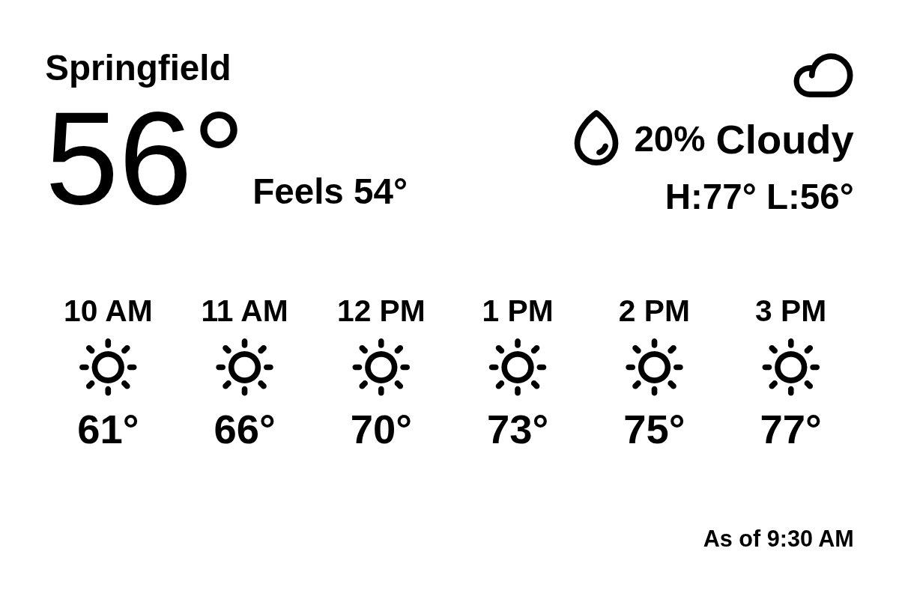

# weather_hourly_card

Today's weather as a single card, in the style of a phone weather widget: the
place and the current temperature (with a smaller "feels like" beside it), the
condition with the chance of rain and today's high and low on the right, and a
row of the next few hours underneath, each with an icon and a temperature.
A small "As of 9:30 AM" line sits at the foot of the card, because an e-ink
panel only repaints on its refresh schedule and the reading is older than the
clock by the time you look at it.

## Options

- **Place**: search for a city, or paste a `lat, lon` pair.
- **Place name**: shown at the top left; auto-filled from the place you pick.
- **Hours shown**: 4, 5, 6 (default) or 8 hourly columns.
- **Units**: Imperial (°F, default) or Metric (°C).
- **Clock**: 12-hour (`3 PM`, default) or 24-hour (`15:00`), for the hourly
  columns and the "As of" time.

Every label goes through Tesserae's `ctx.t`, with the English strings in
`strings/en.json`, so a translation is a matter of adding `strings/<locale>.json`
(and listing the locale in `plugin.json`).

The text uses the dashboard's own font (the theme's `--font-family`), so the
card matches whatever the rest of the dashboard looks like.

## Data and network

One call per refresh to `api.open-meteo.com` (no key): current temperature,
feels-like and condition, today's high and low, and the hourly temperature,
condition and chance of precipitation. Every time on the card is the
location's own local time, whatever zone the Tesserae server runs in. The
answer is cached for 10 minutes. No settings or secrets are read, and nothing
is written outside the widget's data directory.

The chance of rain is Open-Meteo's precipitation probability for the current
hour. The conditions are Open-Meteo's modelled weather, not an observation.

## Licence

AGPL-3.0-or-later, the same as Tesserae.
